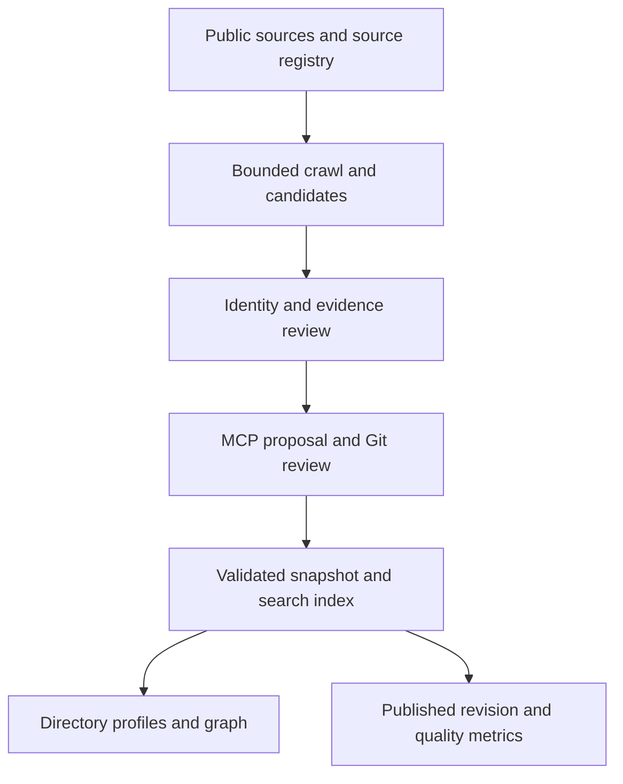

# Startup Atlas knowledge graph roadmap

This is the implementation and data-acquisition plan for a source-backed directory that lets a founder navigate from a programme or investor to supported startups, the people who founded them, and their other sourced ventures. The approved graph concept is the visual direction; it is not yet the shipped interactive graph.

The [tracking issue](https://github.com/castlemilk/startup-atlas/issues/67) and linked work items below are the executable backlog. Status reflects the baseline on 13 November 2026 at source revision `1e7e8377146f572ed45e68cb4fb92ad026e64794`; later merges can change counts and capabilities.

## Verified baseline

| Area | Current state | Consequence |
| --- | --- | --- |
| Graph | 319 entities: 202 partners, 83 providers, 26 startups, 8 people; 69 sourced edges, 5 funding rounds, 10 article links. | A useful seed, not a complete ecosystem. The firm and provider categories can represent overlapping real-world organizations. |
| Wider records | 103 opportunities, 202 partner leads, 27 reviewed partner records, 11 partner profiles, 27 company listings and 19 profile-team listings. | These source datasets are not all represented in the SQLite snapshot. Company/team listings are rows, not necessarily unique entities. |
| Images | The current reference audit reports 14/27 company listings and 55/103 opportunities with an image reference. | A reference is not proof an image loads, is correct, has adequate resolution, or may be reused. |
| Database | A build-generated SQLite/FTS4 file contains graph entities, edges, rounds and article links; the measured snapshot is approximately 204 KiB. | It is an immutable browser read model, not a shared writable database. Other public data files remain separate. |
| Website | The graph page searches entities and displays a startup detail panel; partner profiles show company names. | Dedicated founder/startup routes, reverse traversal and a visual graph still need to be implemented. |
| Collector | Curated sources cover partner, programme, logo, profile and news discovery; the repository workflow is manually dispatched. | Crawl candidates and captured images need review; source coverage and partial scans must be measured. |
| MCP | The connected remote service successfully reads current partner and opportunity data. Its exposed connector tools include opportunity proposal tools; newer startup proposal code is in the repository but not exposed by the live tool catalogue inspected here. | Repository code is not evidence of a deployed MCP capability. Verify the private MCP and Pages deployments separately. |
| Source scale | Startmate's public portfolio describes more than 300 companies; the current Startmate profile contains three company listings. | This is a high-value acquisition target, not a promise that every listed company can automatically be imported. |

Sources: [Startmate portfolio](https://www.startmate.com/portfolio), [collector workflow](https://github.com/castlemilk/startup-atlas/blob/main/.github/workflows/partner-research.yml), [current knowledge graph notes](https://github.com/castlemilk/startup-atlas/blob/main/docs/KNOWLEDGE-GRAPH.md). Image counts are mapping references from `scripts/audit-image-coverage.mjs`; there has been no complete live asset validation in this scoping pass.

## Target architecture and ownership

1. **Reviewed sources of truth:** versioned, human-reviewable canonical input records and source evidence in the repository. Preserve curated `scripts/make-data.py`, `data/opportunities-added.json`, `data/partners-reviewed.json`, `data/partner-profiles.json`, `data/startup-research.json`, source registries, screenshot leads, relationship definitions, logo mappings and approved asset metadata until a migration proves exact parity. Generated files such as `data/catalogue.json` and `data/graph.json` must not become independently editable competing authorities.
2. **Discovery and review:** bounded per-source crawls produce candidates with provenance and crawl status. Store raw research artifacts separately from the public read model; review identity, claim, date and image before accepting them. Candidate approval becomes a revision-checked MCP proposal or an equivalent reviewable pull request.
3. **One public read model:** CI generates a versioned SQLite snapshot containing all approved public records, relationship/evidence metadata, and indexed text. Retain any publicly needed geography, mappings and content not yet normalized in a documented source-document table. Source assets can remain files or external links, but their metadata, identity and attribution belong in the database. A checked manifest must prove each approved input field is accounted for.
4. **Publication:** one build produces matching site assets, database, graph export, image references and a manifest with source SHA, schema version, checksums and counts. Publish only after validation, and keep a known-good previous release. Daily rebuild is a freshness mechanism, not a substitute for acquiring new data.
5. **Readers:** the static site uses the same database for directory, profiles, cross-entity search and graph traversal. A browser-local WASM database is read only and may be memory-limited; provide an accessible JSON/list fallback. Private MCP reads must report the source/published revisions separately.
6. **Writers:** MCP validates and proposes changes against an expected GitHub revision, with idempotent retries and review. A submitted proposal is not published. Merging reviewed data starts the snapshot/index build; verify the public revision and search result before reporting completion.
7. **Growth path:** retain the zero-cost target using measured usage and a stop condition. Evaluate D1 or R2 only for a concrete bottleneck; neither browser WASM persistence nor object storage alone supplies a multi-user transactional write service.

## Required data contract

All identifiers below are stable opaque IDs. Human-readable slugs are aliases for URLs, never the only identity. Store each meaningful fact as an attributed, dated claim rather than silently overwriting a previously reviewed value.

| Record | Required and optional fields | Rules and navigation |
| --- | --- | --- |
| Organization | ID, display/legal/trading names, aliases, entity types, official domain and website, description, status, founded date if known, jurisdictions and external identifiers. | The same organization can be a firm, investor, provider and programme operator. Model those as roles, not automatic duplicates. |
| Partner or VC | Organization reference, investor/accelerator/studio categories, sectors, stages, investment geography, office locations, application routes and related team. | Separate a portfolio listing, an accelerator participation and a specific round investment. Store where each came from. |
| Startup | ID, names/aliases, official URL, description, sectors, status, founding date, operating places, logo, founders and cited sources. | A missing founder, country or funding amount means unknown, not zero. Preserve company renames and merger redirects. |
| Person | ID, name and aliases, professional biography, public professional URLs, portrait reference and dated role records. | Use evidence and more than a name to resolve identities. Do not import private contact data, demographics or sensitive personal data. |
| Programme and cohort | Operator, name, access route, status, locations, eligible applicant countries, audience, application dates/timezone, terms, costs/equity, support/credit amount and source versions. | A programme location or a provider office is not applicant eligibility. Associate cohorts and participants with evidence. |
| Relationship | Source ID, predicate, target ID, direction, display label, valid-from/to, qualifiers, status, and one or more evidence claims. | Allowed types include `founded`, `works_at`, `supports`, `invested_in_round`, `operates_program`, `participated_in`, `program_partner`, `offers`, `acquired` and `subsidiary_of`. Define inverses and endpoint constraints. |
| Funding round | Stable event ID, startup, instrument, stage, announcement/close date, amount, currency, valuation and currency, investors, lead flag and evidence. | Distinguish announced round total from a single investor’s contribution; unknown amount is nullable. Do not silently convert currencies or imply a current valuation. |
| News and evidence | Canonical URL, publisher, title, publication/update dates, retrieval time, source type, relevant entity, short evidence locator and review decision. | A search hit is a lead, not proof. Link to original publishers; avoid storing full unlicensed articles or unrelated images. |
| Asset | Subject ID, type, source page and asset URL, copyright/usage assessment, attribution, file hash, MIME, dimensions, variants, retrieval/review dates and availability. | Validate the actual subject. A scraped portfolio logo or social hero is not automatically the host organization's logo. |
| Source and observation | Source ID, owner/host, type, agreed fetch mode, version/parser, cursor, last checked/success, status, checksum, expected and actual coverage, limitations and review state. | Keep failure, partial scan and closed-source states explicit. Capture observed time separately from when the underlying statement was true. |
| Geography | Country ISO code, region, locality, optional coordinates and the meaning of that place. | Distinguish headquarters, office, investment geography, programme venue and applicant eligibility. |

### Identity, evidence and time

- Match on multiple signals: official domain, verified external identifier, legal name, place and relationship context. Exact names are useful candidates, not a merge guarantee. Apply stricter thresholds to people and common/short names.
- Every merge needs an audit record, preserved old IDs and a reversible mapping. Avoid using normalized-slug collisions as an excuse to join records. Retain former domains and reviewed aliases.
- Store claims as `subject + predicate + value/target + source + evidence location + observed_at + valid_from/valid_to + review_status`. Allow multiple supporting or contradictory claims. Define a deterministic display policy and surface contested, historical and unknown status.
- Original screenshots supplied 183 distinct names, with the provider identity unconfirmed by the screenshots alone. Maintain them as leads until a separate source confirms a specific relationship. An asserted provider–partner relationship does not guarantee a startup is eligible for an award.
- Monetary values retain original currency, amount range/precision, as-of date and whether an amount is disclosed. An 'up to' value is not an awarded amount. Preserve conditions and source text sufficient to assess meaning.

## Source acquisition plan

The first priority is better coverage of existing Australian and New Zealand records, then a broader provider, region and ecosystem inventory. Each adapter must define expected pages/records, pagination termination, extraction method, rate and freshness; a network or parser failure is not a successful zero-result scan.

| Source | Priority and data to acquire | Interpretation and action |
| --- | --- | --- |
| [Startmate portfolio](https://www.startmate.com/portfolio), [demo day](https://www.startmate.com/demo-day), cohort articles | P1: company names, descriptions, cohort, explicit founder names and source links. | Portfolio and cohort listings provide distinct evidence; discover every available page and report actual coverage before claiming it. |
| [Airtree portfolio](https://www.airtree.vc/companies), [Blackbird portfolio](https://www.blackbird.vc/portfolio) and [team](https://www.blackbird.vc/team) | P1: companies, people, role and explicitly stated portfolio/partnered date or stage. | Verify complete names and exact round participation against the startup or an announcement; repeated cards are deduplicated. |
| [Australian grants and programmes finder](https://business.gov.au/grants-and-programs/), [LaunchVic](https://launchvic.org/), Australian state and territory authorities, university accelerators | P1: public programmes, operators, eligibility, dates, startup cohorts and regional firms. | Assess each jurisdiction and source independently; programme status, eligibility and opening dates change. |
| [ABN Lookup](https://abr.business.gov.au/Tools/WebServices) | P1 candidate for Australian legal-entity verification. | The free web service requires registration and a GUID; eligibility and agreement require separate assessment. An ABN alone is not proof of funding, identity across brands or programme eligibility. |
| [Victoria ecosystem database](https://launchvic.org/startup-database/) | Discovery opportunity. | The linked Dealroom product requires registration; its availability as a directory does not establish permission for automated or bulk reuse. Seek a permitted route before integrating. |
| [Vercel for Startups](https://vercel.com/startups/credits), [AWS Activate](https://aws.amazon.com/aws-startups/learn/everything-you-need-to-know-about-aws-activate-credits/), [Microsoft Investor Network](https://learn.microsoft.com/en-us/startups/standard-benefits/unlock-more-benefits) | P1: programme terms and source-backed named provider–partner associations. | Record whether evidence is provider-confirmed or partner self-report, current or historical. Credit limits and proof/referral requirements are programme-specific. |
| [Wikidata data access](https://www.wikidata.org/wiki/Wikidata:Data_access) | P1 secondary identity and discovery: IDs, domains, founders, HQ and links where present. | Structured Wikidata data is CC0, but individual linked photos and logos have separate rights. Verify claims against primary evidence where possible. |
| [GDELT DOC API](https://blog.gdeltproject.org/gdelt-doc-2-0-api-debuts/) and official startup/investor newsrooms | P1: source URL/title/date candidates and funding-news leads. | Search result rankings, coverage windows and ambiguous names limit recall; confirm funding against a primary announcement and retain a publisher link. |
| Official homepages, brand kits, structured Organization/Person data | P1: logos, headshots, social links and brand metadata. | Rank candidates by context; check image identity, dimensions, byte format, attribution and usage before publication. No automated assumption based only on a filename or favicon. |

Other investor, accelerator and accelerator-cohort sources belong in the registry with individual review notes before crawling. LinkedIn and other social URLs may be used as explicitly sourced links when the correct public profile is verified; the plan does not assume an unrestricted scraping API.

## Collector and review mechanics

- **Frontier:** maintain durable per-source pages/cursors, discovered canonical URLs, content hashes/ETags where supported, fetch attempts, parser versions and next eligible fetch. Scope to allowlisted public HTTPS sources, with per-host concurrency/rate caps, timeouts, size limits, redirect and resolved-address checks. The owner has requested no robots.txt requests.
- **Adaptation:** support structured JSON-LD, semantic HTML, cards, tables, sitemaps/RSS and source-specific pagination; keep a parser fixture for every adapter. A rendered-browser adapter, if needed, is separately budgeted, bounded and must not bypass access controls. Detect layout drift and expected-count shortfalls.
- **Events:** extract evidence blocks first, then create candidate organizations, people, relationships, media, rounds and articles. Separate extraction confidence from review confidence. Treat names, dates, currencies and claims as independently reviewable; record source URLs/locators for each.
- **Review:** stage candidate→match→approve/reject/defer decisions. Show a compact diff against the current record, potential duplicates, source context, images and ambiguous fields. Reject stale expected revisions and preserve idempotency on retries. Only approved facts flow into a PR; a successful crawl does not prove an accepted record.
- **Coverage:** record sources planned/attempted/completed/partial/failed; pages expected/fetched; discovered/already-known/ambiguous/rejected/accepted/published; reasons; asset download/approval/render status; and oldest review. Compute coverage only against an explicitly named bounded source and timestamp. There is no reliable denominator for every startup worldwide.
- **Freshness:** use source-specific intervals and prioritize time-sensitive programme deadlines/benefits over stable organization identity. A missing page, disabled programme, source rename and temporary HTTP failure have different meanings. Track the last good observation and never delete a fact solely on a transient failure.

## Product and UI acceptance

- **Main directory:** search/filter across providers, firms, programmes, startups and people by name/alias, country, sector and source-backed relationships. Each result has a stable deep link. Country selectors explain whether the field is headquarters, operating region or programme eligibility.
- **Partner → startup:** a partner profile shows sourced portfolio/cohort links; each opens a startup profile with source and relationship context, rather than rendering the company name as a dead end.
- **Startup → founder → startup:** startup profiles show named founders, investor relationships, programme participation, rounds, news and sources where available. Founder profiles list their other independently evidenced startups and roles. Browser Back, refresh, shared links and redirects work throughout.
- **Graph explorer:** implement the approved warm editorial visual direction, with a legible focused network, typed node marks, one/two-hop expansion, source-backed edges, selected-entity panel, searchable entities, type/country filters, zoom/reset and useful list view. Show provenance and historical/unknown status. Limit graph density, do not fabricate nodes or edges, and maintain an accessible keyboard/screen-reader equivalent.
- **Search reliability:** SQLite FTS indexes names, aliases, descriptions and approved connection terms. Define exact and typo behavior, ranking, result limits and filters. Rebuild after reviewed changes; stale-index and unavailable-WASM states have explicit fallback.
- **Media and attribution:** distinguish missing/unreviewed/rejected/broken assets from a valid logo or portrait; use accessible alt text, responsive sizes, suitable contrast and stable fallbacks. Avoid duplicating source credit everywhere if a clear nearby source is available.
- **History and wiki:** record provenance and versioned facts with readable source links, funding timeline and dated news. Support corrections and disputed/historical information; do not produce an unreferenced generated biography.

## MCP, consistency and release tests

- Keep public GitHub inputs and immutable published SQLite read model consistent. MCP mutation tools validate source and ID shape, protect existing omitted fields, require expected revision, return a preview/diff and create a reviewable PR. They must not claim they have verified a source or published a draft.
- Live tool discovery, OAuth connection, GitHub authorization, Worker bindings and public site revision are independent checks. Publishing the repository does not publish the private MCP service.
- Minimum tests: input parity; identity collisions/merge/redirect; claim source/time semantics; SQL foreign keys and FTS rebuild; funding currencies/unknowns; parser fixtures for pagination/429/truncation; media MIME and wrong-identity rejection; revision conflict/idempotency; deployed MCP protocol; keyboard/mobile graph; and the full reviewed fixture journey from proposal to fresh UI.
- Gate the build on source manifest, database integrity, missing assets, count parity and index revision. Exercise network and WASM failure paths and hold the last good public version on failure. Include a rollback procedure.
- Security and maintenance: parameterized SQL, HTML/URL escaping, content-size limits, safe redirects and image handling; no untrusted SVG execution. Exclude credentials, private drafts and unpublished crawl snapshots from the public database.

## Cost envelope and triggers

As of this plan, GitHub Pages documents a 1 GB published-site limit and a soft 100 GB/month bandwidth limit; standard hosted Actions usage for public repositories is free subject to GitHub's terms and limits. Pages also describes restrictions on using it to run a commercial SaaS, so reassess hosting suitability if the product's use changes. Monitor website and artifact sizes, bandwidth, build minutes, crawl requests and private MCP resource use rather than assuming an unlimited free service.

Cloudflare's published Workers Free D1 allowance is 5 million rows read/day, 100,000 rows written/day and 5 GB stored; exceeding the free daily read/write limit prevents further D1 queries until reset. R2 Standard currently includes 10 GB-month, 1 million Class A and 10 million Class B operations monthly, with charges above those quantities and a subscription checkout. Workers Free has its own daily request and CPU limits. These are alternatives to evaluate, not services already provisioned or a promise that R2 will always cost zero. Use current vendor pricing before a migration and define alerts plus a hard stop.

Budget worksheet: collect real baseline traffic and snapshot size; calculate `monthly downloads × transferred snapshot bytes`, peak daily crawler/worker requests, total stored asset bytes, and D1 rows scanned/written if used. Model current and 10× scenarios and set review thresholds before approaching provider limits. The existing snapshot loads in memory per browser: measure low-end mobile performance and use a Web Worker, caching or sharding only after evidence warrants it.

Sources: [GitHub Pages limits](https://docs.github.com/en/pages/getting-started-with-github-pages/github-pages-limits), [GitHub Actions billing](https://docs.github.com/en/billing/concepts/product-billing/github-actions), [D1 pricing](https://developers.cloudflare.com/d1/platform/pricing/), [R2 pricing](https://developers.cloudflare.com/r2/pricing/), [Workers limits](https://developers.cloudflare.com/workers/platform/limits/), [SQLite WASM persistence](https://sqlite.org/wasm/doc/trunk/persistence.md).

## Delivery sequence

1. **Foundation:** DATA-01/02/03 define canonical input inventory, stable identities and source-backed claims. DATA-04 builds the complete database/index with parity and rollback.
2. **First usable journey:** UX-01/02/04 provide real startup and person links/search; UX-03 turns the visual concept into a usable graph. QA-01 proves the cross-entity path.
3. **MCP and collection:** MCP-01 verifies the live proposal service. CRAWL-01 establishes resilient collection; CRAWL-02/03/04 target Startmate, Airtree, Australia and cloud networks. REVIEW-01/02 close the evidence and identity loop.
4. **Depth:** CRAWL-05 through 09 enrich founders, funding, news, media and programme terms. OPS-01 measures bounded coverage and failures.
5. **Scale and polish:** OPS-02 through 04 and UX-05 address cost thresholds, browser scale, scheduled operations and accessibility/discoverability. Reprioritize based on measured coverage and performance.

## Work items

Priority means P0 establishes the usable data and navigation path, P1 expands evidence and operational coverage, and P2 hardens at scale. Dependencies reference the stable issue codes in this table.

| Priority | Issue | Scope | Depends on |
| --- | --- | --- | --- |
| P0 | [DATA-01](https://github.com/castlemilk/startup-atlas/issues/70) | Inventory and import the complete public catalogue into SQLite | — |
| P0 | [DATA-02](https://github.com/castlemilk/startup-atlas/issues/68) | Introduce stable entity IDs, aliases and safe merge/redirect rules | DATA-01 |
| P0 | [DATA-03](https://github.com/castlemilk/startup-atlas/issues/71) | Model source-attributed claims and time-bounded graph relationships | DATA-02 |
| P0 | [DATA-04](https://github.com/castlemilk/startup-atlas/issues/69) | Build reproducible database, search index and atomic publication | DATA-01, DATA-02, DATA-03 |
| P0 | [MCP-01](https://github.com/castlemilk/startup-atlas/issues/74) | Deploy and verify the hosted MCP graph proposal lifecycle | DATA-02, DATA-03, DATA-04 |
| P0 | [QA-01](https://github.com/castlemilk/startup-atlas/issues/75) | Exercise the complete record-to-index-to-navigation release path | DATA-04, MCP-01, UX-01, UX-02, UX-03 |
| P0 | [UX-01](https://github.com/castlemilk/startup-atlas/issues/72) | Create navigable partner, startup and programme profiles | DATA-02, DATA-03, DATA-04 |
| P0 | [UX-02](https://github.com/castlemilk/startup-atlas/issues/73) | Add founder and people profiles with reverse startup navigation | DATA-02, DATA-03, UX-01 |
| P0 | [UX-03](https://github.com/castlemilk/startup-atlas/issues/79) | Build the visual knowledge graph explorer | DATA-03, DATA-04, UX-01 |
| P0 | [UX-04](https://github.com/castlemilk/startup-atlas/issues/76) | Unify search and filters across providers, partners, startups and people | DATA-02, DATA-04 |
| P1 | [CRAWL-01](https://github.com/castlemilk/startup-atlas/issues/77) | Create a persistent crawl frontier, source registry and recovery model | DATA-03 |
| P1 | [CRAWL-02](https://github.com/castlemilk/startup-atlas/issues/78) | Ingest Startmate and Airtree portfolios and cohort pages | CRAWL-01, DATA-02, DATA-03 |
| P1 | [CRAWL-03](https://github.com/castlemilk/startup-atlas/issues/80) | Expand Australian VC, accelerator and government programme coverage | CRAWL-01, CRAWL-02 |
| P1 | [CRAWL-04](https://github.com/castlemilk/startup-atlas/issues/83) | Verify Vercel, AWS and Microsoft startup provider linkages | DATA-03, CRAWL-01 |
| P1 | [CRAWL-05](https://github.com/castlemilk/startup-atlas/issues/81) | Enrich startup, founder and firm profiles from primary sources | CRAWL-01, DATA-02, DATA-03 |
| P1 | [CRAWL-06](https://github.com/castlemilk/startup-atlas/issues/84) | Extract and reconcile funding rounds and investor participation | DATA-03, CRAWL-05 |
| P1 | [CRAWL-07](https://github.com/castlemilk/startup-atlas/issues/82) | Discover source-linked startup news and funding announcements | CRAWL-01, DATA-03 |
| P1 | [CRAWL-08](https://github.com/castlemilk/startup-atlas/issues/85) | Improve logo and headshot discovery, review and rendering | CRAWL-01, DATA-02 |
| P1 | [CRAWL-09](https://github.com/castlemilk/startup-atlas/issues/86) | Model programme eligibility, terms, cohorts and change detection | DATA-03, CRAWL-01 |
| P1 | [REVIEW-01](https://github.com/castlemilk/startup-atlas/issues/87) | Build a candidate review queue and evidence decision workflow | DATA-03, MCP-01, CRAWL-01 |
| P1 | [REVIEW-02](https://github.com/castlemilk/startup-atlas/issues/88) | Implement entity matching and human resolution of ambiguous leads | DATA-02, REVIEW-01 |
| P1 | [OPS-01](https://github.com/castlemilk/startup-atlas/issues/89) | Measure source coverage, freshness and crawl health | CRAWL-01, REVIEW-01 |
| P1 | [OPS-02](https://github.com/castlemilk/startup-atlas/issues/92) | Set zero-cost architecture budgets and growth thresholds | DATA-04, OPS-01 |
| P2 | [OPS-03](https://github.com/castlemilk/startup-atlas/issues/91) | Scale browser database loading and incremental updates | DATA-04, UX-03, UX-04 |
| P2 | [OPS-04](https://github.com/castlemilk/startup-atlas/issues/90) | Automate crawl schedules, release observability and recovery | CRAWL-01, REVIEW-01, OPS-01 |
| P2 | [UX-05](https://github.com/castlemilk/startup-atlas/issues/93) | Harden graph and profile accessibility, deep links and discoverability | UX-01, UX-02, UX-03 |
