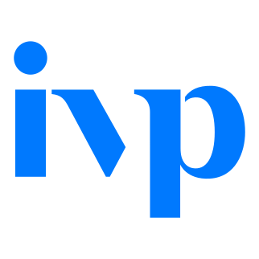
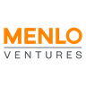

# Partner index

A browsable snapshot of the **183 names** in the original screenshot index, reviewed against the repository on 12 November 2026. Names are research leads; a listing or logo does not establish a provider partnership, membership, or eligibility for credits. Some names are ambiguous and need identity verification.

[Browse the live directory](https://castlemilk.github.io/startup-atlas/?view=partners#directory) · [Logo sources and attribution](../assets/logos/README.md) · [Research and crawler instructions](../README.md)

Each name links to its search in Startup Atlas. Official websites and summaries appear only where individually reviewed. A dash means no reviewed logo or website is available in the current repository; it does not mean the organisation has none. The 1,547 leads from the separate GitHub directory crawl remain in the [review artifact](https://github.com/castlemilk/startup-atlas/actions/runs/43130494557/artifacts/13903989321) and are not yet part of this index. That artifact expires on 26 November 2026.

## 0–9

| Logo | Partner | Reviewed website and details |
| --- | --- | --- |
| — | [17Sigma](https://castlemilk.github.io/startup-atlas/?view=partners&q=17Sigma#directory) | Not yet reviewed |
| — | [645 Ventures](https://castlemilk.github.io/startup-atlas/?view=partners&q=645%20Ventures#directory) | Not yet reviewed |
| — | [776](https://castlemilk.github.io/startup-atlas/?view=partners&q=776#directory) | Not yet reviewed |
|  | [8VC](https://castlemilk.github.io/startup-atlas/?view=partners&q=8VC#directory) | Not yet reviewed |

## A

| Logo | Partner | Reviewed website and details |
| --- | --- | --- |
|  | [a16z](https://castlemilk.github.io/startup-atlas/?view=partners&q=a16z#directory) | Not yet reviewed |
|  | [Accel](https://castlemilk.github.io/startup-atlas/?view=partners&q=Accel#directory) | Not yet reviewed |
| — | [Accel Community](https://castlemilk.github.io/startup-atlas/?view=partners&q=Accel%20Community#directory) | Not yet reviewed |
| — | [Acrew](https://castlemilk.github.io/startup-atlas/?view=partners&q=Acrew#directory) | Not yet reviewed |
| — | [Afore](https://castlemilk.github.io/startup-atlas/?view=partners&q=Afore#directory) | Not yet reviewed |
| — | [AGI House](https://castlemilk.github.io/startup-atlas/?view=partners&q=AGI%20House#directory) | Not yet reviewed |
| — | [AI Grant](https://castlemilk.github.io/startup-atlas/?view=partners&q=AI%20Grant#directory) | Not yet reviewed |
| — | [AIR](https://castlemilk.github.io/startup-atlas/?view=partners&q=AIR#directory) | Not yet reviewed |
| — | [Airtree](https://castlemilk.github.io/startup-atlas/?view=partners&q=Airtree#directory) | [Official website](https://www.airtree.vc/) · Venture capital firm backing technology founders in Australia and New Zealand, with founder and investor community programmes. ([source](https://www.airtree.vc/)) |
| — | [Alif](https://castlemilk.github.io/startup-atlas/?view=partners&q=Alif#directory) | Not yet reviewed |
| — | [Alliance](https://castlemilk.github.io/startup-atlas/?view=partners&q=Alliance#directory) | Not yet reviewed |
| — | [Alumni Ventures](https://castlemilk.github.io/startup-atlas/?view=partners&q=Alumni%20Ventures#directory) | Not yet reviewed |
| — | [Amity](https://castlemilk.github.io/startup-atlas/?view=partners&q=Amity#directory) | Not yet reviewed |
| — | [Amplify Partners](https://castlemilk.github.io/startup-atlas/?view=partners&q=Amplify%20Partners#directory) | Not yet reviewed |
| — | [Animo](https://castlemilk.github.io/startup-atlas/?view=partners&q=Animo#directory) | Not yet reviewed |
|  | [Antler](https://castlemilk.github.io/startup-atlas/?view=partners&q=Antler#directory) | Not yet reviewed |
| — | [Ardent Ventures](https://castlemilk.github.io/startup-atlas/?view=partners&q=Ardent%20Ventures#directory) | Not yet reviewed |

## B

| Logo | Partner | Reviewed website and details |
| --- | --- | --- |
| — | [B Capital](https://castlemilk.github.io/startup-atlas/?view=partners&q=B%20Capital#directory) | Not yet reviewed |
|  | [Bain Capital Ventures](https://castlemilk.github.io/startup-atlas/?view=partners&q=Bain%20Capital%20Ventures#directory) | Not yet reviewed |
| — | [Balderton](https://castlemilk.github.io/startup-atlas/?view=partners&q=Balderton#directory) | Not yet reviewed |
| — | [basecase](https://castlemilk.github.io/startup-atlas/?view=partners&q=basecase#directory) | Not yet reviewed |
| — | [Berkeley SkyDeck](https://castlemilk.github.io/startup-atlas/?view=partners&q=Berkeley%20SkyDeck#directory) | Not yet reviewed |
|  | [Bessemer](https://castlemilk.github.io/startup-atlas/?view=partners&q=Bessemer#directory) | Not yet reviewed |
| — | [BetterFutureLabs](https://castlemilk.github.io/startup-atlas/?view=partners&q=BetterFutureLabs#directory) | Not yet reviewed |
|  | [Blackbird Ventures](https://castlemilk.github.io/startup-atlas/?view=partners&q=Blackbird%20Ventures#directory) | Not yet reviewed |
| — | [Boost Capital Partners](https://castlemilk.github.io/startup-atlas/?view=partners&q=Boost%20Capital%20Partners#directory) | Not yet reviewed |
| — | [Boost VC](https://castlemilk.github.io/startup-atlas/?view=partners&q=Boost%20VC#directory) | Not yet reviewed |
|  | [Boxgroup](https://castlemilk.github.io/startup-atlas/?view=partners&q=Boxgroup#directory) | Not yet reviewed |
| — | [BTV](https://castlemilk.github.io/startup-atlas/?view=partners&q=BTV#directory) | Not yet reviewed |
| — | [Bufficorn Ventures](https://castlemilk.github.io/startup-atlas/?view=partners&q=Bufficorn%20Ventures#directory) | Not yet reviewed |

## C

| Logo | Partner | Reviewed website and details |
| --- | --- | --- |
| — | [Caffeinated Capital](https://castlemilk.github.io/startup-atlas/?view=partners&q=Caffeinated%20Capital#directory) | Not yet reviewed |
| — | [Canonical](https://castlemilk.github.io/startup-atlas/?view=partners&q=Canonical#directory) | Not yet reviewed |
| — | [Cardinal Ventures](https://castlemilk.github.io/startup-atlas/?view=partners&q=Cardinal%20Ventures#directory) | Not yet reviewed |
| — | [Carthona](https://castlemilk.github.io/startup-atlas/?view=partners&q=Carthona#directory) | Not yet reviewed |
| — | [Category VC](https://castlemilk.github.io/startup-atlas/?view=partners&q=Category%20VC#directory) | Not yet reviewed |
| — | [Charge](https://castlemilk.github.io/startup-atlas/?view=partners&q=Charge#directory) | Not yet reviewed |
| — | [Cherry VC](https://castlemilk.github.io/startup-atlas/?view=partners&q=Cherry%20VC#directory) | Not yet reviewed |
| — | [Coinbase Ventures](https://castlemilk.github.io/startup-atlas/?view=partners&q=Coinbase%20Ventures#directory) | Not yet reviewed |
| — | [Cold Start](https://castlemilk.github.io/startup-atlas/?view=partners&q=Cold%20Start#directory) | Not yet reviewed |
| — | [Concept VC](https://castlemilk.github.io/startup-atlas/?view=partners&q=Concept%20VC#directory) | Not yet reviewed |
| — | [Craft Ventures](https://castlemilk.github.io/startup-atlas/?view=partners&q=Craft%20Ventures#directory) | Not yet reviewed |
|  | [CRV](https://castlemilk.github.io/startup-atlas/?view=partners&q=CRV#directory) | Not yet reviewed |
| — | [Cygnus](https://castlemilk.github.io/startup-atlas/?view=partners&q=Cygnus#directory) | Not yet reviewed |

## D

| Logo | Partner | Reviewed website and details |
| --- | --- | --- |
| — | [Dawn Capital](https://castlemilk.github.io/startup-atlas/?view=partners&q=Dawn%20Capital#directory) | Not yet reviewed |
| — | [Denarii Labs](https://castlemilk.github.io/startup-atlas/?view=partners&q=Denarii%20Labs#directory) | Not yet reviewed |
| — | [Denver Ventures](https://castlemilk.github.io/startup-atlas/?view=partners&q=Denver%20Ventures#directory) | Not yet reviewed |
| — | [Designer Fund](https://castlemilk.github.io/startup-atlas/?view=partners&q=Designer%20Fund#directory) | Not yet reviewed |
| — | [dlab](https://castlemilk.github.io/startup-atlas/?view=partners&q=dlab#directory) | Not yet reviewed |
| — | [Dormroom Fund](https://castlemilk.github.io/startup-atlas/?view=partners&q=Dormroom%20Fund#directory) | Not yet reviewed |
| — | [Draper](https://castlemilk.github.io/startup-atlas/?view=partners&q=Draper#directory) | Not yet reviewed |

## E

| Logo | Partner | Reviewed website and details |
| --- | --- | --- |
| — | [Elad Gil](https://castlemilk.github.io/startup-atlas/?view=partners&q=Elad%20Gil#directory) | Not yet reviewed |
| — | [Electric Capital](https://castlemilk.github.io/startup-atlas/?view=partners&q=Electric%20Capital#directory) | Not yet reviewed |
| — | [Embed](https://castlemilk.github.io/startup-atlas/?view=partners&q=Embed#directory) | Not yet reviewed |
| — | [Emblem VC](https://castlemilk.github.io/startup-atlas/?view=partners&q=Emblem%20VC#directory) | Not yet reviewed |
| — | [emcap](https://castlemilk.github.io/startup-atlas/?view=partners&q=emcap#directory) | Not yet reviewed |
| — | [Entrepreneur First](https://castlemilk.github.io/startup-atlas/?view=partners&q=Entrepreneur%20First#directory) | Not yet reviewed |
| — | [Everyday Intelligence](https://castlemilk.github.io/startup-atlas/?view=partners&q=Everyday%20Intelligence#directory) | Not yet reviewed |
| — | [EWOR](https://castlemilk.github.io/startup-atlas/?view=partners&q=EWOR#directory) | Not yet reviewed |

## F

| Logo | Partner | Reviewed website and details |
| --- | --- | --- |
| — | [F Prime](https://castlemilk.github.io/startup-atlas/?view=partners&q=F%20Prime#directory) | Not yet reviewed |
| — | [Fika](https://castlemilk.github.io/startup-atlas/?view=partners&q=Fika#directory) | Not yet reviewed |
| — | [FirstMark](https://castlemilk.github.io/startup-atlas/?view=partners&q=FirstMark#directory) | Not yet reviewed |
| — | [firstminute capital](https://castlemilk.github.io/startup-atlas/?view=partners&q=firstminute%20capital#directory) | Not yet reviewed |
| — | [Flex Capital](https://castlemilk.github.io/startup-atlas/?view=partners&q=Flex%20Capital#directory) | Not yet reviewed |
| — | [Floodgate](https://castlemilk.github.io/startup-atlas/?view=partners&q=Floodgate#directory) | Not yet reviewed |
|  | [Flybridge](https://castlemilk.github.io/startup-atlas/?view=partners&q=Flybridge#directory) | Not yet reviewed |
| — | [Focal](https://castlemilk.github.io/startup-atlas/?view=partners&q=Focal#directory) | Not yet reviewed |
| — | [Footwork](https://castlemilk.github.io/startup-atlas/?view=partners&q=Footwork#directory) | Not yet reviewed |
| — | [Forerunner](https://castlemilk.github.io/startup-atlas/?view=partners&q=Forerunner#directory) | Not yet reviewed |
| — | [Foundation](https://castlemilk.github.io/startup-atlas/?view=partners&q=Foundation#directory) | Not yet reviewed |
| — | [Founders Factory](https://castlemilk.github.io/startup-atlas/?view=partners&q=Founders%20Factory#directory) | Not yet reviewed |
|  | [Founders Fund](https://castlemilk.github.io/startup-atlas/?view=partners&q=Founders%20Fund#directory) | Not yet reviewed |
| — | [Founders Inc](https://castlemilk.github.io/startup-atlas/?view=partners&q=Founders%20Inc#directory) | Not yet reviewed |
| — | [Fractal](https://castlemilk.github.io/startup-atlas/?view=partners&q=Fractal#directory) | Not yet reviewed |
| — | [Frontier](https://castlemilk.github.io/startup-atlas/?view=partners&q=Frontier#directory) | Not yet reviewed |

## G

| Logo | Partner | Reviewed website and details |
| --- | --- | --- |
| — | [Galvanizer](https://castlemilk.github.io/startup-atlas/?view=partners&q=Galvanizer#directory) | Not yet reviewed |
| — | [Garage VC](https://castlemilk.github.io/startup-atlas/?view=partners&q=Garage%20VC#directory) | Not yet reviewed |
|  | [General Catalyst](https://castlemilk.github.io/startup-atlas/?view=partners&q=General%20Catalyst#directory) | Not yet reviewed |
| — | [Genesis Accelerator](https://castlemilk.github.io/startup-atlas/?view=partners&q=Genesis%20Accelerator#directory) | Not yet reviewed |
| — | [Google Ventures](https://castlemilk.github.io/startup-atlas/?view=partners&q=Google%20Ventures#directory) | Not yet reviewed |
|  | [Greylock](https://castlemilk.github.io/startup-atlas/?view=partners&q=Greylock#directory) | Not yet reviewed |
| — | [Ground Up](https://castlemilk.github.io/startup-atlas/?view=partners&q=Ground%20Up#directory) | Not yet reviewed |

## H

| Logo | Partner | Reviewed website and details |
| --- | --- | --- |
| — | [Haatch](https://castlemilk.github.io/startup-atlas/?view=partners&q=Haatch#directory) | Not yet reviewed |
| — | [Hashed](https://castlemilk.github.io/startup-atlas/?view=partners&q=Hashed#directory) | Not yet reviewed |
| — | [Haystack](https://castlemilk.github.io/startup-atlas/?view=partners&q=Haystack#directory) | Not yet reviewed |
| — | [Hetz VC](https://castlemilk.github.io/startup-atlas/?view=partners&q=Hetz%20VC#directory) | Not yet reviewed |
| — | [Hexa](https://castlemilk.github.io/startup-atlas/?view=partners&q=Hexa#directory) | Not yet reviewed |
| — | [HOF](https://castlemilk.github.io/startup-atlas/?view=partners&q=HOF#directory) | Not yet reviewed |
| — | [Humans in the Loop](https://castlemilk.github.io/startup-atlas/?view=partners&q=Humans%20in%20the%20Loop#directory) | Not yet reviewed |
| — | [Hustle Fund](https://castlemilk.github.io/startup-atlas/?view=partners&q=Hustle%20Fund#directory) | Not yet reviewed |

## I

| Logo | Partner | Reviewed website and details |
| --- | --- | --- |
| — | [IBUP](https://castlemilk.github.io/startup-atlas/?view=partners&q=IBUP#directory) | Not yet reviewed |
| — | [Icebreaker VC](https://castlemilk.github.io/startup-atlas/?view=partners&q=Icebreaker%20VC#directory) | Not yet reviewed |
| — | [ICONIQ](https://castlemilk.github.io/startup-atlas/?view=partners&q=ICONIQ#directory) | Not yet reviewed |
| — | [imec](https://castlemilk.github.io/startup-atlas/?view=partners&q=imec#directory) | Not yet reviewed |
|  | [Index Ventures](https://castlemilk.github.io/startup-atlas/?view=partners&q=Index%20Ventures#directory) | Not yet reviewed |
| — | [Inspired Capital](https://castlemilk.github.io/startup-atlas/?view=partners&q=Inspired%20Capital#directory) | Not yet reviewed |
|  | [IVP](https://castlemilk.github.io/startup-atlas/?view=partners&q=IVP#directory) | Not yet reviewed |

## K

| Logo | Partner | Reviewed website and details |
| --- | --- | --- |
| — | [Kaszek](https://castlemilk.github.io/startup-atlas/?view=partners&q=Kaszek#directory) | Not yet reviewed |
|  | [Khosla](https://castlemilk.github.io/startup-atlas/?view=partners&q=Khosla#directory) | Not yet reviewed |
|  | [Kleiner Perkins](https://castlemilk.github.io/startup-atlas/?view=partners&q=Kleiner%20Perkins#directory) | Not yet reviewed |

## L

| Logo | Partner | Reviewed website and details |
| --- | --- | --- |
| — | [Latitud](https://castlemilk.github.io/startup-atlas/?view=partners&q=Latitud#directory) | Not yet reviewed |
| — | [Lerer Hippeau](https://castlemilk.github.io/startup-atlas/?view=partners&q=Lerer%20Hippeau#directory) | Not yet reviewed |
|  | [Lightspeed](https://castlemilk.github.io/startup-atlas/?view=partners&q=Lightspeed#directory) | Not yet reviewed |
| — | [Liminal Venture Studio](https://castlemilk.github.io/startup-atlas/?view=partners&q=Liminal%20Venture%20Studio#directory) | Not yet reviewed |
| — | [Long Journey Ventures](https://castlemilk.github.io/startup-atlas/?view=partners&q=Long%20Journey%20Ventures#directory) | Not yet reviewed |
|  | [Lux Capital](https://castlemilk.github.io/startup-atlas/?view=partners&q=Lux%20Capital#directory) | Not yet reviewed |

## M

| Logo | Partner | Reviewed website and details |
| --- | --- | --- |
| — | [M12](https://castlemilk.github.io/startup-atlas/?view=partners&q=M12#directory) | Not yet reviewed |
| — | [Madrona](https://castlemilk.github.io/startup-atlas/?view=partners&q=Madrona#directory) | Not yet reviewed |
| — | [MARU](https://castlemilk.github.io/startup-atlas/?view=partners&q=MARU#directory) | Not yet reviewed |
| — | [Matrix](https://castlemilk.github.io/startup-atlas/?view=partners&q=Matrix#directory) | Not yet reviewed |
|  | [Menlo Ventures](https://castlemilk.github.io/startup-atlas/?view=partners&q=Menlo%20Ventures#directory) | Not yet reviewed |
| — | [Mento](https://castlemilk.github.io/startup-atlas/?view=partners&q=Mento#directory) | Not yet reviewed |
| — | [MetaProp](https://castlemilk.github.io/startup-atlas/?view=partners&q=MetaProp#directory) | Not yet reviewed |
| — | [Moxxie](https://castlemilk.github.io/startup-atlas/?view=partners&q=Moxxie#directory) | Not yet reviewed |
| — | [Mucker](https://castlemilk.github.io/startup-atlas/?view=partners&q=Mucker#directory) | Not yet reviewed |

## N

| Logo | Partner | Reviewed website and details |
| --- | --- | --- |
| — | [Neo](https://castlemilk.github.io/startup-atlas/?view=partners&q=Neo#directory) | Not yet reviewed |
| — | [Newtopia](https://castlemilk.github.io/startup-atlas/?view=partners&q=Newtopia#directory) | Not yet reviewed |
| — | [Notable Capital](https://castlemilk.github.io/startup-atlas/?view=partners&q=Notable%20Capital#directory) | Not yet reviewed |

## O

| Logo | Partner | Reviewed website and details |
| --- | --- | --- |
| — | [ODF](https://castlemilk.github.io/startup-atlas/?view=partners&q=ODF#directory) | Not yet reviewed |
| — | [Offline](https://castlemilk.github.io/startup-atlas/?view=partners&q=Offline#directory) | Not yet reviewed |
| — | [Operator Collective](https://castlemilk.github.io/startup-atlas/?view=partners&q=Operator%20Collective#directory) | Not yet reviewed |
| — | [Outward VC](https://castlemilk.github.io/startup-atlas/?view=partners&q=Outward%20VC#directory) | Not yet reviewed |

## P

| Logo | Partner | Reviewed website and details |
| --- | --- | --- |
| — | [PAA](https://castlemilk.github.io/startup-atlas/?view=partners&q=PAA#directory) | Not yet reviewed |
| — | [Pantera](https://castlemilk.github.io/startup-atlas/?view=partners&q=Pantera#directory) | Not yet reviewed |
| — | [Paradigm](https://castlemilk.github.io/startup-atlas/?view=partners&q=Paradigm#directory) | Not yet reviewed |
| — | [Paralect Venture Studio](https://castlemilk.github.io/startup-atlas/?view=partners&q=Paralect%20Venture%20Studio#directory) | Not yet reviewed |
| — | [Partech](https://castlemilk.github.io/startup-atlas/?view=partners&q=Partech#directory) | Not yet reviewed |
| — | [Pear](https://castlemilk.github.io/startup-atlas/?view=partners&q=Pear#directory) | Not yet reviewed |
| — | [Perceptive Ventures](https://castlemilk.github.io/startup-atlas/?view=partners&q=Perceptive%20Ventures#directory) | Not yet reviewed |
| — | [Platanus](https://castlemilk.github.io/startup-atlas/?view=partners&q=Platanus#directory) | Not yet reviewed |
| — | [Primary](https://castlemilk.github.io/startup-atlas/?view=partners&q=Primary#directory) | Not yet reviewed |
| — | [Prod](https://castlemilk.github.io/startup-atlas/?view=partners&q=Prod#directory) | Not yet reviewed |
|  | [Product Hunt](https://castlemilk.github.io/startup-atlas/?view=partners&q=Product%20Hunt#directory) | Not yet reviewed |

## R

| Logo | Partner | Reviewed website and details |
| --- | --- | --- |
| — | [Rackhouse](https://castlemilk.github.io/startup-atlas/?view=partners&q=Rackhouse#directory) | Not yet reviewed |
| — | [Reach Capital](https://castlemilk.github.io/startup-atlas/?view=partners&q=Reach%20Capital#directory) | Not yet reviewed |
| — | [Residency (Monad)](https://castlemilk.github.io/startup-atlas/?view=partners&q=Residency%20(Monad)#directory) | Not yet reviewed |
| — | [Residency VC](https://castlemilk.github.io/startup-atlas/?view=partners&q=Residency%20VC#directory) | Not yet reviewed |
| — | [Resolute](https://castlemilk.github.io/startup-atlas/?view=partners&q=Resolute#directory) | Not yet reviewed |

## S

| Logo | Partner | Reviewed website and details |
| --- | --- | --- |
| — | [Scribble](https://castlemilk.github.io/startup-atlas/?view=partners&q=Scribble#directory) | Not yet reviewed |
| — | [Seedcamp](https://castlemilk.github.io/startup-atlas/?view=partners&q=Seedcamp#directory) | Not yet reviewed |
|  | [Sequoia Capital](https://castlemilk.github.io/startup-atlas/?view=partners&q=Sequoia%20Capital#directory) | Not yet reviewed |
| — | [Side Stage Ventures](https://castlemilk.github.io/startup-atlas/?view=partners&q=Side%20Stage%20Ventures#directory) | [Official website](https://www.sidestage.vc/) · Early-stage venture investor supporting founders building companies from Australia. ([source](https://www.sidestage.vc/)) |
| — | [Slow](https://castlemilk.github.io/startup-atlas/?view=partners&q=Slow#directory) | Not yet reviewed |
| — | [Soma Capital](https://castlemilk.github.io/startup-atlas/?view=partners&q=Soma%20Capital#directory) | Not yet reviewed |
| — | [Sound Ventures](https://castlemilk.github.io/startup-atlas/?view=partners&q=Sound%20Ventures#directory) | Not yet reviewed |
| — | [South Park Commons](https://castlemilk.github.io/startup-atlas/?view=partners&q=South%20Park%20Commons#directory) | Not yet reviewed |
|  | [Spark Capital](https://castlemilk.github.io/startup-atlas/?view=partners&q=Spark%20Capital#directory) | Not yet reviewed |
| — | [Square Peg](https://castlemilk.github.io/startup-atlas/?view=partners&q=Square%20Peg#directory) | [Official website](https://www.squarepeg.vc/) · Venture capital firm backing technology founders in Australia, Israel and Southeast Asia. ([source](https://www.squarepeg.vc/our-philosophy)) |
| — | [Stanford CS](https://castlemilk.github.io/startup-atlas/?view=partners&q=Stanford%20CS#directory) | Not yet reviewed |
|  | [Startmate](https://castlemilk.github.io/startup-atlas/?view=partners&q=Startmate#directory) | [Official website](https://www.startmate.com/) · Startup accelerator supporting founders with a strong connection to Australia or New Zealand. ([source](https://www.startmate.com/faq)) |
| — | [Startout](https://castlemilk.github.io/startup-atlas/?view=partners&q=Startout#directory) | Not yet reviewed |
| — | [StartX](https://castlemilk.github.io/startup-atlas/?view=partners&q=StartX#directory) | Not yet reviewed |
| — | [Station F](https://castlemilk.github.io/startup-atlas/?view=partners&q=Station%20F#directory) | Not yet reviewed |
| — | [Sunflower](https://castlemilk.github.io/startup-atlas/?view=partners&q=Sunflower#directory) | Not yet reviewed |
| — | [Susa Ventures](https://castlemilk.github.io/startup-atlas/?view=partners&q=Susa%20Ventures#directory) | Not yet reviewed |
| — | [Sutter Hill Ventures](https://castlemilk.github.io/startup-atlas/?view=partners&q=Sutter%20Hill%20Ventures#directory) | Not yet reviewed |
| — | [SV Angel](https://castlemilk.github.io/startup-atlas/?view=partners&q=SV%20Angel#directory) | Not yet reviewed |

## T

| Logo | Partner | Reviewed website and details |
| --- | --- | --- |
| — | [The Embassy](https://castlemilk.github.io/startup-atlas/?view=partners&q=The%20Embassy#directory) | Not yet reviewed |
| — | [The GP](https://castlemilk.github.io/startup-atlas/?view=partners&q=The%20GP#directory) | Not yet reviewed |
| — | [The House Fund](https://castlemilk.github.io/startup-atlas/?view=partners&q=The%20House%20Fund#directory) | Not yet reviewed |
| — | [Thrive Capital](https://castlemilk.github.io/startup-atlas/?view=partners&q=Thrive%20Capital#directory) | Not yet reviewed |
| — | [TNT](https://castlemilk.github.io/startup-atlas/?view=partners&q=TNT#directory) | Not yet reviewed |
| — | [Topology](https://castlemilk.github.io/startup-atlas/?view=partners&q=Topology#directory) | Not yet reviewed |
| — | [TQ Ventures](https://castlemilk.github.io/startup-atlas/?view=partners&q=TQ%20Ventures#directory) | Not yet reviewed |
| — | [True Ventures](https://castlemilk.github.io/startup-atlas/?view=partners&q=True%20Ventures#directory) | Not yet reviewed |
| — | [Type Capital](https://castlemilk.github.io/startup-atlas/?view=partners&q=Type%20Capital#directory) | Not yet reviewed |

## U

| Logo | Partner | Reviewed website and details |
| --- | --- | --- |
| — | [Uncork](https://castlemilk.github.io/startup-atlas/?view=partners&q=Uncork#directory) | Not yet reviewed |
| — | [Unshackled](https://castlemilk.github.io/startup-atlas/?view=partners&q=Unshackled#directory) | Not yet reviewed |
| — | [Unusual Ventures](https://castlemilk.github.io/startup-atlas/?view=partners&q=Unusual%20Ventures#directory) | Not yet reviewed |
| — | [Upwest](https://castlemilk.github.io/startup-atlas/?view=partners&q=Upwest#directory) | Not yet reviewed |
| — | [USV](https://castlemilk.github.io/startup-atlas/?view=partners&q=USV#directory) | Not yet reviewed |

## V

| Logo | Partner | Reviewed website and details |
| --- | --- | --- |
| — | [V Connect](https://castlemilk.github.io/startup-atlas/?view=partners&q=V%20Connect#directory) | Not yet reviewed |
| — | [Valor Capital](https://castlemilk.github.io/startup-atlas/?view=partners&q=Valor%20Capital#directory) | Not yet reviewed |
| — | [Variant](https://castlemilk.github.io/startup-atlas/?view=partners&q=Variant#directory) | Not yet reviewed |
| — | [Velocity](https://castlemilk.github.io/startup-atlas/?view=partners&q=Velocity#directory) | Not yet reviewed |
|  | [Vercel AI Accelerator](https://castlemilk.github.io/startup-atlas/?view=partners&q=Vercel%20AI%20Accelerator#directory) | Not yet reviewed |
|  | [Vercel Ventures](https://castlemilk.github.io/startup-atlas/?view=partners&q=Vercel%20Ventures#directory) | Not yet reviewed |

## W

| Logo | Partner | Reviewed website and details |
| --- | --- | --- |
| — | [Wing VC](https://castlemilk.github.io/startup-atlas/?view=partners&q=Wing%20VC#directory) | Not yet reviewed |

## Y

| Logo | Partner | Reviewed website and details |
| --- | --- | --- |
|  | [Y Combinator Bookface](https://castlemilk.github.io/startup-atlas/?view=partners&q=Y%20Combinator%20Bookface#directory) | Not yet reviewed |

## Z

| Logo | Partner | Reviewed website and details |
| --- | --- | --- |
| — | [Z Fellows](https://castlemilk.github.io/startup-atlas/?view=partners&q=Z%20Fellows#directory) | Not yet reviewed |

## Additional sourced organisations

These additions sit outside the historical screenshot index. Follow each source for the exact relationship; a listing does not establish credit eligibility.

| Organisation | Source |
| --- | --- |
| Accel, NVIDIA, Carta, Brex and Y Combinator | [Source](https://startups.aws.com/lp/aws-activate-provider) |
| Henson Venture Partners (self-reported Microsoft Investor Network membership) | [Source](https://www.henson.vc/post/big-news-henson-venture-partners-joins-the-microsoft-for-startups-investor-network) |
| Boab AI, Boson Ventures, Cicada Innovations, CoLabs Australia, HEX, Illume Ventures, Jumpstart Studio, MedTech Actuator and RMIT DiscoveryHUB | [Source](https://launchvic.org/announcements/victoria-backs-next-wave-of-ai-and-deeptech-founders/) |
| [Main Sequence](https://castlemilk.github.io/startup-atlas/?view=partners&q=Main%20Sequence#directory) | [Official website](https://www.mseq.vc/) |
| [Rampersand](https://castlemilk.github.io/startup-atlas/?view=partners&q=Rampersand#directory) | [Official website](https://rampersand.vc/) |
| [Investible](https://castlemilk.github.io/startup-atlas/?view=partners&q=Investible#directory) | [Official website](https://www.investible.com/) |
| [Artesian](https://castlemilk.github.io/startup-atlas/?view=partners&q=Artesian#directory) | [Official website](https://www.artesianinvest.com/) |
| [Brandon Capital](https://castlemilk.github.io/startup-atlas/?view=partners&q=Brandon%20Capital#directory) | [Official website](https://brandoncapital.vc/) |
