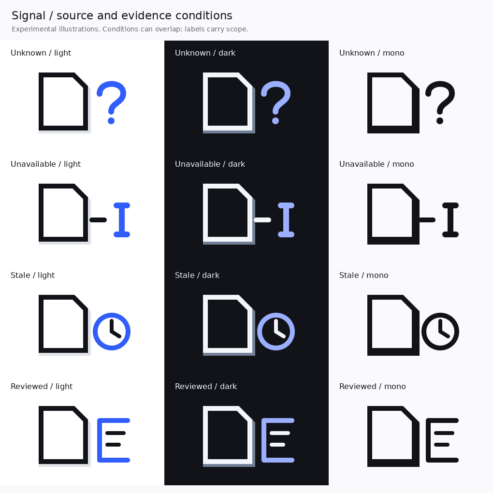

# Signal source and evidence condition illustrations

Four experimental illustrations explain **unknown, unavailable, stale and reviewed** evidence in a bounded source panel. There are twelve transparent SVG exports: light, dark-surface and monochrome versions of each construction. The [standalone gallery](../web/assets/design-lab/signal-evidence-states/r1/index.html) includes meanings, required context, downloads, actual-size specimens and a proposed **Reviewed + Stale** placement.

**Conditions can overlap.** Knowledge, access, freshness and review answer different questions. These assets are not a four-state machine, an evidence classifier, a replacement for research-view loading states or a selected operational identity. A reviewed source may also be stale or temporarily unavailable. The host's records supply the condition and its scope; the illustration supplies no factual verdict.



## Meaning and required context

| Condition | Precise meaning | Keep beside the artwork | Do not imply |
| --- | --- | --- | --- |
| **Unknown** | The specified fact or evidence condition has not been established within the named research scope. | The subject, scope and what has not been established. | Absent, zero, false, failed access, or that every captured but unreviewed candidate is unknown. |
| **Unavailable** | An identified source or resource could not be retrieved in a recorded attempt. | The affected source/section, attempt time and known reason. Retain earlier evidence. | Deleted, nonexistent, false, or that every source failed when only one optional source was unavailable. |
| **Stale** | A recorded observation needs a freshness review under an explicit policy or recorded review decision. | The observation/review date and the policy or reason. For a time-based rule, show the evaluation time. | False, revoked or expired. Age alone does not establish a universal freshness threshold. A build timestamp does not establish factual recency. |
| **Reviewed** | Specified evidence or a claim was examined within a recorded scope and review date. | Source/claim/revision, scope, review date and actual outcome; identify the review record or reviewer when available. | Universally true, complete, endorsed, eligible, currently retrievable, fresh, merged or deployed. A crawl `checked_at` alone is not a review record. |

The gallery's proposed panel uses bracketed placeholders rather than invented company names or dated claims. It keeps a recorded review visible alongside its separate freshness explanation. A later failed access attempt could add another source-specific explanation without erasing the earlier review.

These are presentation conditions, not new fields or enums in the production data model. Main has no automatic stale-evidence classifier or TTL. No rule has been introduced to derive a condition from age, an SVG filename, colour or missing data.

## Construction and artistic direction

The open source frame continues Signal's chamfered geometry and restrained depth. A shallow lower/right return provides relief; the graphite or pale-ink contour carries the actual silhouette. The frontal view and broad details simplify the larger r2 construction for a **64px minimum width**.

| Construction | Distinct cue | Why it fits the condition |
| --- | --- | --- |
| Unknown | A detached question hook and point beside the source frame. | A question remains open; the source is not depicted as a zero-count container. |
| Unavailable | A source-side rail stops before an upright gate, leaving a wide gap. | Access is interrupted at one boundary; the source and earlier records remain intact. |
| Stale | A separate time dial with hands that do not touch its rim. | The date needs context and rechecking; the record remains fully visible. The drawn angles encode no literal time. |
| Reviewed | An open annotation bracket with two short review-note strokes. | Examination leaves a scoped note. There is no checkmark, approval seal or shield. The strokes do not count reviewed claims. |

All four share the same cobalt role. Colour does not map to success, failure or truth. Different cues remain distinct in monochrome. The source windows, outside regions and intentional gaps are genuine transparency, with no background-coloured patches or baked shadows.

The set is deliberately separate from logos and the canonical feature-symbol and utility-icon registries. It has no movement, live status announcements or source requests.

## Reuse and placement

- Use one illustration beside a section-level source explanation, review note or research-method introduction. Pair it with a visible condition label and the context listed above.
- Preserve the complete **256 × 192 viewBox**. Use **64px or larger**; the gallery also demonstrates 96px and 160px placements. Keep existing `atlas-icons.js` symbols for compact 24px controls and dense rows.
- Use the light export on white or Signal canvas; use the dark export on graphite `#111318`. The dark palette is an asset variant, not a new application theme. The graphite monochrome export is intended for the listed light backgrounds.
- For a meaningful standalone image, describe its condition and subject accurately in adjacent text and its accessible name. Where the same explanation already appears beside a decorative repeat, use `alt=""`.
- Keep source links, recorded dates, review outcomes and retry controls as live text/controls. Do not replace loaded evidence with an unavailable image, fade stale evidence away, or promote the illustration into a live status badge.
- For a neutral introduction to source inspection, continue to use [r2 Folio Source](SIGNAL-ASSET-STUDIES-R2.md). A specific evidence condition is not required for that existing asset.

The standalone gallery imports `web/design-tokens.css` and uses scoped local CSS. No shared token, runtime module, UI SDK, framework, operational route or production logo changes are needed to review it.

## Existing equivalents and ownership

Starting revision: [main 2c003beae425507de206fbfa0f48416bd82e78d6](https://github.com/castlemilk/startup-atlas/tree/2c003beae425507de206fbfa0f48416bd82e78d6). It includes r2 through [PR 142](https://github.com/castlemilk/startup-atlas/pull/142), merged at `61cc95af24fcdc28c7d85f5c3ae5273f7e7af340`, and the published motion pilot. [Pages run 44016356214](https://github.com/castlemilk/startup-atlas/actions/runs/44016356214) passed for that baseline. That release establishes the starting point, not deployment of this new collection.

The [design-system Space](https://chatgpt.com/space/page_5167bcbbbb0c81919e1d565fd4d82e4a), [r2 receipt](https://chatgpt.com/space/page_027be865ed248191b1e727c21af74f30), current PRs and existing assets were inspected first. There was no equivalent four-condition illustration family:

| Existing asset or implementation | Role retained |
| --- | --- |
| r2 Folio Source | Generic source-method artwork, explicitly not a reviewed or trusted badge. |
| `illustration-evidence.webp` and `design-handbook.js` | Earlier source-literacy folio/magnifier illustration; preserved as its original direction. |
| `atlas-icons.js` | Canonical source, calendar, info, warning and completed-action check icons. |
| `design-component-specs.js` / `design-workbench.js` | Loading, ready, empty, partial and unavailable view states, distinct from evidence conditions. |
| `entity.js`, `partner-profile.js` and `INDEX-REFRESH.md` | Scope-specific facts, optional-source failures, review dates and the distinction between capture, review, merge and publication. |

[PR 151](https://github.com/castlemilk/startup-atlas/pull/151) owns directory pagination/focus and `VIEW-USAGE.md`; [PR 136](https://github.com/castlemilk/startup-atlas/pull/136) owns its field guide; PR 135 owns optional analytics; PR 107 retains legacy card work. Motion is separately isolating its pilot CSS for embedding, and Hardware remains separately owned. This collection touches none of those files. The existing Pages browser step receives one additional command, preserving its jobs, permissions and artifact destination.

The final pre-publication inspection also found [PR 152](https://github.com/castlemilk/startup-atlas/pull/152), the isolated motion-embedding work, and [PR 153](https://github.com/castlemilk/startup-atlas/pull/153), which distinguishes failed Wikidata metadata fetches from valid empty claims. Their changed-file sets do not overlap this collection. Their implementation and factual outcomes remain with those owners.

## Provenance and reproduction

These are **original authored vector paths**, with no raster tracing, image-model output, external artwork or embedded font. No generation prompt or third-party licence is invented. Repository licensing is unchanged; the collection adds no new licence grant.

The [manifest](../web/assets/design-lab/signal-evidence-states/r1/manifest.json) records the four briefs, semantic boundaries, intended placements, palette snapshots, source-file hashes, named editable layers, viewBox, minimum size and the exact SHA-256/byte count of each SVG. User selection and factual source remain unset. Frozen palette snapshots make this revision reproducible if runtime tokens change later.

```sh
python3 scripts/make-signal-evidence-states.py
python3 -m unittest discover -s tests -p 'test_signal_evidence_states.py'
```

Use `--out /path/to/temporary-directory` to regenerate for comparison without writing the reviewed folder. The generator creates only its twelve SVGs and manifest; it does not rewrite the gallery or prior collections.

The renderer uses already installed Inkscape and Pillow. It downloads nothing:

```sh
python3 scripts/review-signal-evidence-states.py --work-dir /tmp/atlas-evidence-renders
```

It renders all twelve SVGs at **64, 96, 160, 256 and 1600px**, audits painted bounds and transparent cutouts, calculates essential-role contrast on the declared hosts, and writes two matte-backed review sheets plus `vector-review.json`. Re-running intentionally resets `visual_review` to pending; a technical pass does not manufacture an image-inspection result.

## Accessibility and verification boundaries

Essential ink and cobalt are assessed against every declared solid background at a minimum **3:1** source-colour ratio. The shallow relief is decorative; the high-contrast source frame remains complete without it. The actual minimum ratio and each calculation appear in the [vector review](../web/assets/design-lab/signal-evidence-states/r1/vector-review.json). Small-size inspection also checks the question point, access gap, time hands and annotation strokes, because contrast arithmetic alone does not establish legibility.

The approach follows W3C guidance on [non-text contrast](https://www.w3.org/WAI/WCAG22/Understanding/non-text-contrast.html) and [meaning beyond colour](https://www.w3.org/WAI/WCAG22/Understanding/use-of-color.html). The browser suite samples five computed text-colour pairs at **4.5:1**, consistent with [text contrast guidance](https://www.w3.org/WAI/WCAG22/Understanding/contrast-minimum.html). These are scoped checks on the exported assets and standalone gallery, not certification of every host or assistive technology.

```sh
npm ci --ignore-scripts
npm test
npm run build
CHROME_BIN=chromium ATLAS_SCREENSHOTS_DIR=/tmp/atlas-evidence-browser node scripts/test-signal-evidence-states-browser.mjs
```

The existing CI browser step runs the new gallery script. Its independent output directory, `signal-evidence-states-r1/`, preserves the existing r2 report. Checks include source/build/download equality, 1440px desktop and 390/320px mobile, actual-size specimens, local fonts, keyboard focus, native disclosures, no-JavaScript operation, reduced motion and absence of operational data loads. The suite also checks that the gallery states its illustrative scope and overlapping meanings.

Local Chromium is known to be blocked before navigation by the execution environment's Unix-socket restriction. Browser acceptance therefore comes from PR CI; consult the PR and existing Space receipt for the exact reviewed head, run, screenshots and observed result. The artwork and all r1/r2 identity files remain experimental. Merge and publication remain with coordinated review.

### Recorded asset review

Local verification passed **109 JavaScript tests and 70 Python tests**, including ten new evidence-asset contracts, followed by the static-site and SQLite build. All twelve exports passed the conservative static SVG audit. The renderer completed **60 renders** with clear bounds and transparent probes. Minimum essential source-colour contrast was **4.884:1 light**, **8.804:1 dark** and **17.824:1 monochrome** on the declared backgrounds.

Author and independent visual review retained all four constructions. The question point, interrupted access gap, time hands and two annotation strokes survive the 64px specimens. Stale has the tightest source-to-cue gap, so the 64px minimum must be retained. All twelve enlarged exports were inspected. The report records these observations separately from browser acceptance and keeps user identity selection unset.
