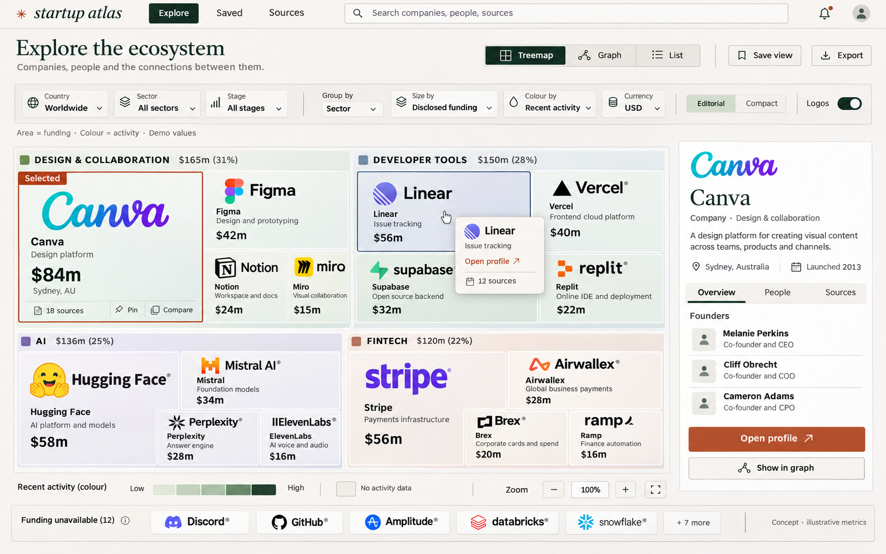
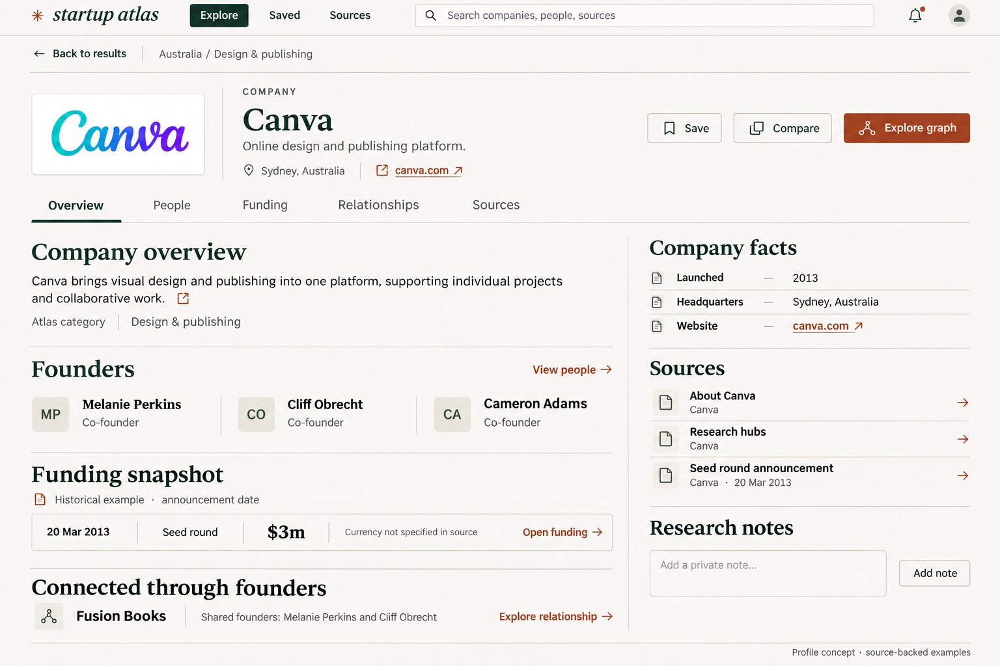

# Startup Atlas — Editorial design direction

Ben approved this **warm editorial target** and requested that the design work be consolidated into the repository. Paper surfaces, forest ink, rust accents, Newsreader headings and Inter controls carry through the explorer, filters, company profiles and evidence panels.

This package contains a specification and 13 generated visual references. Approval of the direction and permission to push the package are distinct from implementation, runtime acceptance and deployment. Existing operational contracts remain in [Signal components](../../SIGNAL-COMPONENTS.md), [UI SDK](../../UI-SDK.md) and the [UX contract](../../../UX-CONTRACT.md).

## Start here

| Resource | Purpose |
|---|---|
| [Design system](design-system.md) | Visual principles, layouts, component contracts, geography, evidence and profile behaviour |
| [Scoped foundation](foundation.css) | Proposed `.atlas` tokens and foundational styles; not an installed theme |
| [Asset manifest](asset-manifest.json) | Portable asset inventory, original filenames and SHA-256 digests |
| [Source fixture](source-fixture.json) | Exact primary-source URLs, dates and boundaries for the Canva examples |
| [Implementation handoff](HANDOFF.md) | Ownership boundaries, source baseline, coordination and acceptance work |
| [Stitch source reference](references/stitch-design.md) | Supplied historical input to the approved direction |

The specification governs tokens, interaction semantics and calculated chart geometry. Images illustrate composition and hierarchy; financial values, counts, country placements, logo renderings and chart proportions must not be transcribed into authoritative records. Source-specific historical examples retain their provenance in the specification.

## Explore the ecosystem

| Reference | What to inspect |
|---|---|
| [Explorer treemap](wireframes/explorer-treemap.png) | Company identity, grouped analytical space, metric controls and inspector continuity |
| [Knowledge graph](wireframes/explorer-graph.png) | Typed entities, explicit relationships and contextual source inspection |
| [Directory and evidence coverage](wireframes/directory-evidence-coverage.png) | Readable rows, source coverage and separate comparison membership |

## Filters, states and core components

| Reference | What to inspect |
|---|---|
| [Country multiselect](wireframes/country-multiselect.png) | Headquarters basis, draft choices, scoped counts and explicit Apply |
| [Country and city drilldown](wireframes/country-city-drilldown.png) | Applied countries versus the narrower visible scope |
| [Group, size and colour controls](wireframes/group-size-colour-controls.png) | Independent representations, matching legends and unavailable options |
| [Filter and result states](wireframes/filter-result-states.png) | Empty results, excluded selection and preserved choices after failure |
| [Mobile explorer](wireframes/mobile-explorer.png) | Filter drawer, result list and contextual inspector sequence |
| [Core components](wireframes/core-components.png) | Typography, colour, controls, logo containment and layout recipes |

## Company profiles

| Reference | What to inspect |
|---|---|
| [Company overview](wireframes/company-overview.png) | Return context, compact identity, editorial body and fact/evidence rail |
| [People and relationships](wireframes/company-people-relationships.png) | Founding history, dated roles, related companies and graph navigation |
| [Funding and evidence](wireframes/company-funding-evidence.png) | Event precision, participant roles, partial coverage and claim inspection |
| [Mobile company profile](wireframes/company-mobile.png) | Readable records, section navigation and dismissible evidence sheet |

These are the selected final references. Superseded cobalt exploration and earlier warm revisions are excluded from this gallery. Generated brand marks are visual references, not cleared production assets; retain canonical asset review when implementing company identities.
